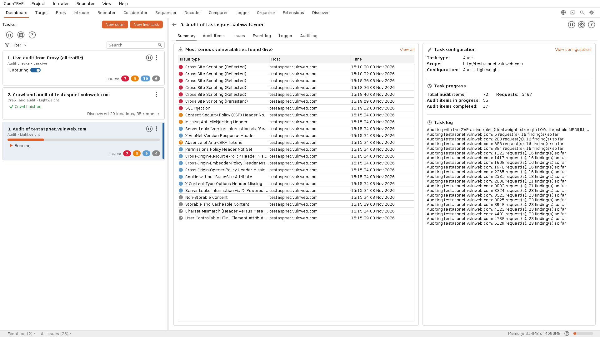
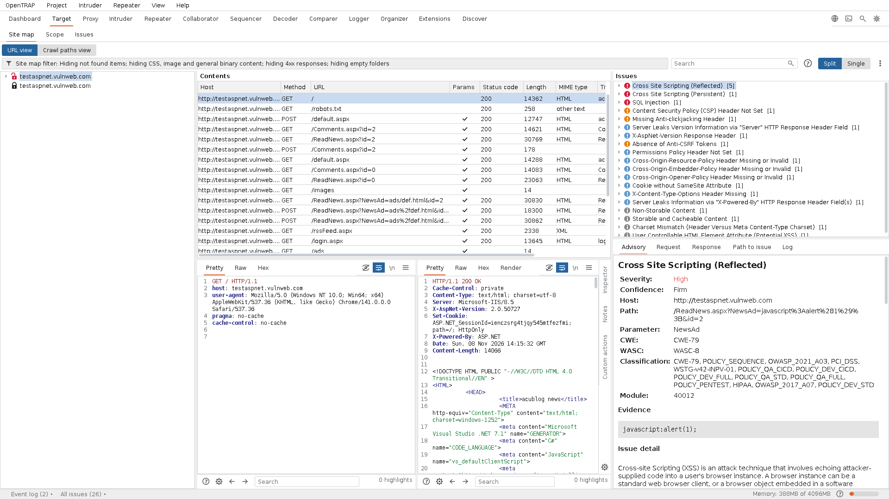
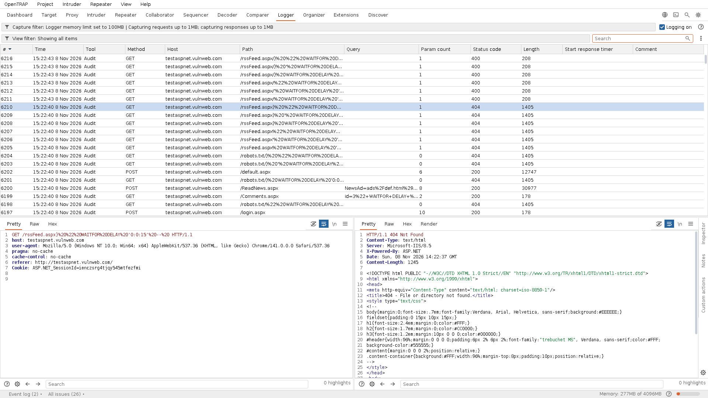

<div align="center">


<p><strong>Open Traffic Replay and Analysis Proxy</strong><br>
A free and open-source alternative to Burp Suite, built on the trusted OWASP ZAP engine.</p>

<p>


</p>

<p>
<a href="https://github.com/opentrap/opentrap/releases/latest/download/opentrap-x86_64.appimage"></a>
&nbsp;
<a href="https://github.com/opentrap/opentrap/stargazers"></a>
&nbsp;
<a href="https://github.com/opentrap/opentrap/releases/latest"></a>
</p>

<sub><b>Share:</b>
<a href="https://twitter.com/intent/tweet?text=OpenTRAP%2C%20an%20open-source%20web%20security%20testing%20suite&url=https%3A%2F%2Fgithub.com%2Fopentrap%2Fopentrap">X</a> &middot;
<a href="https://www.linkedin.com/sharing/share-offsite/?url=https%3A%2F%2Fgithub.com%2Fopentrap%2Fopentrap">LinkedIn</a> &middot;
<a href="https://www.reddit.com/submit?url=https%3A%2F%2Fgithub.com%2Fopentrap%2Fopentrap&title=OpenTRAP">Reddit</a> &middot;
<a href="https://news.ycombinator.com/submitlink?u=https%3A%2F%2Fgithub.com%2Fopentrap%2Fopentrap&t=OpenTRAP">Hacker News</a>
</sub>

</div>

<p align="center"><b>One command to download and run it:</b></p>

```
wget https://github.com/opentrap/opentrap/releases/latest/download/opentrap-x86_64.appimage && chmod +x opentrap-x86_64.appimage && ./opentrap-x86_64.appimage
```

<div align="center">

<a href="docs/images/dashboard.png"></a>

<p><sub>The Dashboard after a scan: the crawl's locations and requests, the audit's findings by severity, and the most serious vulnerabilities as they were confirmed.</sub></p>

</div>

---

## Free and open source

OpenTRAP is free and open source software, released under the GNU AGPL v3.0 with
no licence gate on anything. We stand with the organisations that make free and
open source software possible - if OpenTRAP is useful to you, consider supporting them.

<p align="center">
<a href="https://www.fsf.org/"></a>
&nbsp;&nbsp;&nbsp;&nbsp;&nbsp;&nbsp;
<a href="https://opensource.org/"></a>
&nbsp;&nbsp;&nbsp;&nbsp;&nbsp;&nbsp;
<a href="https://sfconservancy.org/"></a>
&nbsp;&nbsp;&nbsp;&nbsp;&nbsp;&nbsp;
<a href="https://fsfe.org/"></a>
&nbsp;&nbsp;&nbsp;&nbsp;&nbsp;&nbsp;
<a href="https://www.eff.org/"></a>
</p>

---

## Why we built it

The most capable intercepting proxies, such as Burp Suite, are commercial and
closed, with their most useful features behind a paid licence. OWASP ZAP is a
powerful open engine, but its interface is unfamiliar to the many testers who work
proxy-first. OpenTRAP brings the two together: a familiar Burp-style workflow on
top of the trusted OWASP ZAP detection engine, open and familiar to anyone who has
worked with an intercepting proxy before.

It is a complete testing workspace that anyone can run, inspect and extend, with no
licence gate on its core capabilities, built to be improved by the people who use
it rather than steered by a single vendor's roadmap.

## What it is

A proxy-first workspace for web application testing. Capture, inspect, replay and
tamper with the traffic between a browser and a web application. Map an
application's attack surface, and drive repeatable manual and automated testing
from one window: interception, HTTP history, a target site map and scope, a request
toolset, an out-of-band collaborator, and a complete log of everything that runs.

It is built for penetration testers, bug bounty hunters, AppSec engineers and
students who want a professional intercepting-proxy workflow without a commercial
licence.

## See it in action

<table>
<tr>
<td width="50%" valign="top">
<a href="docs/images/target.png"></a>
<br><sub><b>Target</b><br>Site map with a padlock per host (open for http, closed for https), out-of-scope hosts greyed, and every issue found with the advisory, request and response beside it.</sub>
</td>
<td width="50%" valign="top">
<a href="docs/images/logger.png"></a>
<br><sub><b>Logger</b><br>A complete, filterable record of every request OpenTRAP and the scan engine make, newest first and tagged by the tool that sent it.</sub>
</td>
</tr>
</table>

More screenshots are on the
[project site](https://opentrap.github.io/opentrap/#screenshots).

## Help build OpenTRAP

OpenTRAP is a community project and contributions are welcome. If you can fix a
bug, patch a rough edge, sharpen the UI, add a feature or improve the docs, your
contribution is wanted. You do not need permission to improve it.

- Every change is reviewed, merged and **credited** to its author.
- One-line fixes are as welcome as whole new features.
- Bug reports and concrete ideas help too.
- Found a security problem in OpenTRAP itself? [SECURITY.md](SECURITY.md)
  explains how to report it privately.

If OpenTRAP is useful to you, star the repository and share it (buttons at the
top). See [CONTRIBUTING.md](CONTRIBUTING.md) to get started, then open an issue or
a pull request.

## Roadmap

OpenTRAP is built in the open, and so is its to-do list. Every feature that is
laid out in the interface but not implemented yet is in **[ROADMAP.md](ROADMAP.md)**,
each with a stable reference code such as `OT-INTRUDER-RESPOOL`. Using one of those
features in the app opens a dialog that names the same code, explains how to
contribute it, and offers a one-click copy of a short build anchor. The
**Discover > Roadmap** tab shows the same list inside the app.

Pick an item, quote its code in your pull request, and it is merged with full
credit. To discuss a feature or ask for it to be prioritised, open an issue.

There are no AI features on the roadmap, by design. A security tool runs in
environments where sending traffic to a third-party model is not acceptable, so
OpenTRAP ships none and will not add any.

## Scanning and detection

Point OpenTRAP at a target and it crawls the application, maps what it finds, and
audits it for real vulnerabilities: injection, cross-site scripting, broken access
control, information disclosure, misconfiguration and more. Findings land in a
clear issue view with the request, response and the matched evidence highlighted,
ready to triage or hand straight to a developer. The detection is built on the
proven OWASP ZAP engine, so what OpenTRAP reports holds up.

Choose how hard a scan digs with a scan configuration: Lightweight, Fast,
Balanced or Deep. Every tier tests the same ground, so they differ only in how
far the crawl reaches and how hard the audit probes, never in what gets checked.
For full control there is a Custom configuration with its own settings screen,
exposing crawl depth, attack strength, the input points tested and more.

## Highlights

- **Proxy-first by design** - intercept, replay and edit live traffic, with the whole toolset one click away.
- **Detection that stands up** - crawl and audit with the proven OWASP ZAP engine, so the findings hold up.
- **Everything in one window** - repeater, intruder, sequencer, decoder, comparer, collaborator and a full logger.
- **One self-contained file** - every release is a single Linux AppImage with its own runtime and the scan engine built in; download it and run it.
- **Open and hackable** - AGPL v3.0: read it, change it, extend it, with no gate on its core capabilities.
- **Guided from the start** - open or create a project at launch, then drive crawl-and-audit scans through a step-by-step wizard.
- **Scan configurations that fit the job** - pick a tier from Lightweight to Deep, build a Custom scan with full control over crawl depth, attack strength and the inputs tested, and save it to the configuration library for next time.
- **Projects that open in seconds** - a saved project with tens of thousands of requests loads in a few seconds without freezing the window.
- **Projects that stay small** - the crawl, your own traffic and every finding are kept in full; the audit's thousands of probe requests are kept as headers only, so a scan-heavy project is a fraction of the size. Save a copy with in-scope items only to shrink it further, and see where the bytes go under Project > Project size.
- **Scope that keeps the noise out** - add a host or a path to scope from the site map, and the proxy offers to stop recording everything else; the site map and history filters hide out-of-scope, not-found and static content the way you would expect, and a scan crawls and attacks only what the scope covers.
- **Newest first, everywhere** - every history in the suite, from the proxy and the Logger to Intruder results and Collaborator interactions, lists the latest entry at the top, so what just happened is always in view.
- **One Settings dialog** - every tool's settings in one place, reachable from the gear in the top bar or from the tool itself.
- **Built to be improved** - shaped by the people who use it, with every contribution credited and a public [roadmap](ROADMAP.md).

## The toolset

| Tool | What it does |
|------|--------------|
| **Dashboard** | Live tasks, issues and event log; start a scan from the guided wizard, choosing a configuration from Lightweight to Deep or a Custom one |
| **Target** | Site map tree with a padlock per host, a full filter, and the suite-wide scope (URL prefixes, or regex rules) that governs every tool and binds the scan engine |
| **Proxy** | Intercept, filtered HTTP history, WebSocket capture, HTTP and WebSocket match and replace, per-host certificate authority |
| **Scanner** | Configure the engine's active and passive rules (enable, disable, threshold) |
| **Logger** | A complete record of every request OpenTRAP and the engine make |
| **Intruder** | Four attack types with payload sets and processing |
| **Repeater** | Edit and reissue a request, one numbered tab at a time |
| **Collaborator** | Out-of-band interaction capture for blind vulnerabilities |
| **Organizer** | Stash and annotate interesting requests for later |
| **Sequencer** | Token randomness analysis with entropy tests |
| **Decoder / Comparer** | Chained encode/decode/hash transforms, and item diffs |
| **Extensions** | Laid out and on the roadmap: loading, the catalogue and custom checks are open for contribution |
| **Discover** | A getting-started guide and the live roadmap |

Right-click any request or response to send it between tools. Settings for every
tool live in one Settings dialog (the gear in the top bar), including session
handling rules, the testing browser and the scan configuration library.

Open or create a project when OpenTRAP starts, kick off a crawl-and-audit scan
through a step-by-step wizard, and let in-scope proxy traffic be passively
audited as you browse.

## Get started

Download the one file and run it. There is nothing to install: the AppImage
carries its own Java runtime and the scan engine inside it.

**[Download the latest AppImage](https://github.com/opentrap/opentrap/releases/latest/download/opentrap-x86_64.appimage)** - this link always points at the newest release.

Linux does not let a freshly downloaded file run until you allow it, so the
first time you need to mark it runnable. The quickest way, no terminal needed:

1. Right-click the downloaded **opentrap-x86_64.appimage** and choose **Properties**.
2. On the **Permissions** tab, tick **Allow executing file as a program**.
3. Close, then **double-click** the file to launch OpenTRAP.

Prefer the terminal? Three lines do the same:

```
wget https://github.com/opentrap/opentrap/releases/latest/download/opentrap-x86_64.appimage
chmod +x opentrap-x86_64.appimage
./opentrap-x86_64.appimage
```

The download is complete: the Java runtime and the scan engine are inside the
file and set themselves up on first use. Every release is this one AppImage, so
nothing ships with parts missing.
The optional testing browser is an in-app download, offered only when you want it,
so the release stays small.

The fastest way to test a target is the built-in browser: on the **Proxy** tab
click **open browser**. It launches a bundled Chromium in an isolated profile,
already routed through the proxy and already trusting OpenTRAP's certificate
authority, so there is nothing to configure and no certificate to install.

## Build from source

```
./build.sh      # compile src/ into a lean dev jar (uses an engine already on disk)
./test.sh       # run the test suite
./run.sh        # launch the dev build
```

`./install-desktop.sh` adds a menu entry for your development build, so it sits
in your applications list beside the AppImage. No root needed; pass `--system`
to install it for all users instead.

Releasing is a maintainer job, described in
[MAINTAINING.md](MAINTAINING.md): `./release.sh` builds the self-contained
release jar and `./package-appimage.sh` packs the AppImage that is published.

The only compiled-in dependencies are BouncyCastle (the proxy CA) and a Brotli
decoder. The scan engine, testing browser and a portable JDK are fetched on
demand by `./fetch-zap.sh`, `./fetch-browser.sh` and `./fetch-jdk.sh`; bundled
versions are pinned in `tools/versions`. The portable JDK (Eclipse Temurin, built
on an old glibc) is what lets the AppImage run across distributions rather than
only on the build host. See `DEPENDENCIES.md`.

## FAQ

**Is there a free, open-source alternative to Burp Suite?**
Yes. OpenTRAP gives you the intercepting-proxy workflow Burp users know, with Proxy,
Repeater, Intruder, Collaborator, Sequencer, Decoder and Comparer, under the AGPL-3.0
with no paid tier and no feature gate.

**What is the difference between OpenTRAP and OWASP ZAP?**
OpenTRAP uses the OWASP ZAP engine for crawling and scanning, and puts a familiar,
Burp-style interface and workflow on top of it. If you trust ZAP's detection but want
a proxy-first workspace, OpenTRAP is that front end.

**Does it have Repeater, Intruder and a Collaborator?**
Yes, along with HTTP history, a target site map and scope, a sequencer, a decoder, a
comparer and a full traffic logger, all in one window.

**Which platforms does it run on?**
Today OpenTRAP ships as a single self-contained Linux AppImage. It needs nothing
installed: the Java runtime and the scan engine are inside the file.

**How big do project files get?**
A project keeps every page the crawl fetched, everything you did by hand and every
finding with its full request and response. An audit sends thousands of probe
requests per endpoint, and those are kept as headers only, so a scan-heavy project is
roughly a tenth of the size it would otherwise be. The Logger still lists every probe
while the session is open. Settings > Project can keep the probe bodies too, cap
large response bodies, and stop the proxy recording out-of-scope traffic. Project >
Project size shows where the bytes go, and Project > Save copy writes a smaller copy
with in-scope items only or fewer tools.

**Is it really free?**
Yes. OpenTRAP is released under the GNU AGPL v3.0. Every capability is open, with
nothing reserved for a paid edition.

## Licence

OpenTRAP is released under the **GNU Affero General Public License v3.0**. You are
free to use, study, modify and share it; if you distribute a modified version or
run one as a network service, you release your changes under the same licence, so
improvements stay open for everyone. The full text is in [LICENSE](LICENSE).

---

<sub>OpenTRAP is independent open-source software. It bundles third-party
open-source components under their respective licences; see
[CREDITS.md](CREDITS.md).</sub>
