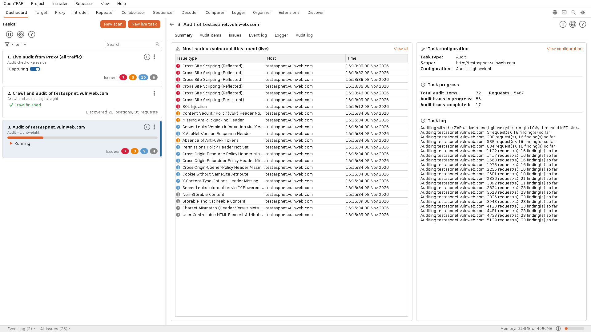
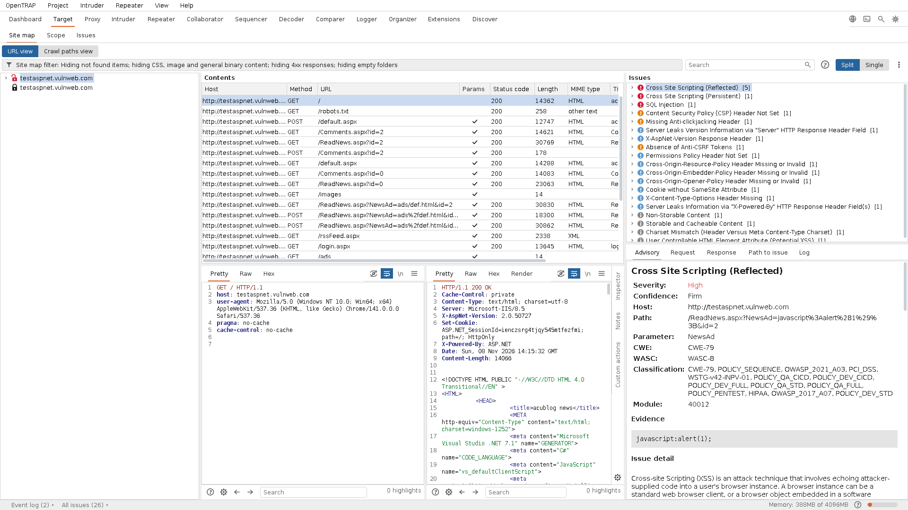
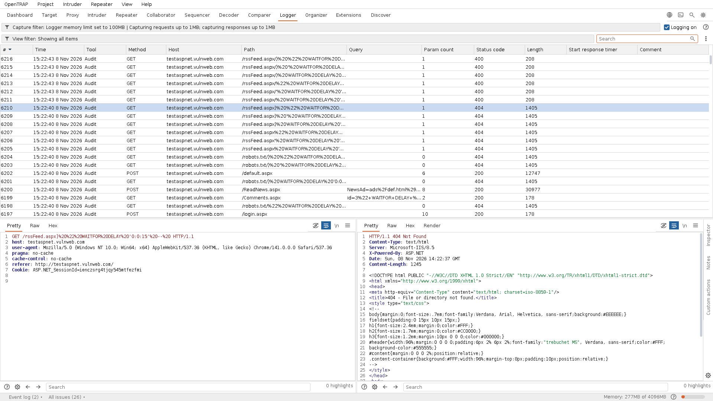

<section class="hero">

  

    <h1>OpenTRAP</h1>
    
A free, open-source alternative to Burp Suite

    
Capture, inspect, replay and tamper with the traffic between a browser and a web application, then crawl and audit it for real vulnerabilities. One self-contained download, no licence gate, powered by the OWASP ZAP engine.

    

      <a class="btn btn-primary" href="https://github.com/opentrap/opentrap/releases/latest/download/opentrap-x86_64.appimage">&#8681;&nbsp; Download for Linux</a>
      <a class="btn btn-ghost" href="https://github.com/opentrap/opentrap/releases/latest">Go straight to releases</a>
    

  

  

    
  

</section>

<section class="osband" id="software-freedom">

  

    <h2>Proudly free and open source</h2>
    
OpenTRAP is free and open source software, released under the GNU AGPL v3.0 with no licence gate on anything. We stand with the organisations that make free and open source software possible - if OpenTRAP is useful to you, consider supporting them.

  

  

    
    
    
    
    
  

</section>

<section class="band" id="features">

  <h2>Everything in one window</h2>
  
A proxy-first workspace with the whole toolset one click away, built around a detection engine that holds up.

  

    
    <ul class="checks">
      <li><b>A complete proxy-first suite</b>Intercept, HTTP history, repeater, intruder, sequencer, decoder, comparer, an out-of-band collaborator and a full traffic logger.</li>
      <li><b>Scanning that holds up</b>Crawl and audit for real vulnerabilities on the proven OWASP ZAP engine, with findings in a clear issue view and the evidence highlighted.</li>
      <li><b>Guided from the start</b>Open or create a project at launch, then drive crawl-and-audit scans through a step-by-step wizard.</li>
      <li><b>Scan configurations that fit the job</b>Pick a tier from Lightweight to Deep, or build a Custom scan with full control over crawl depth, attack strength and which inputs are tested.</li>
      <li><b>Scope that keeps the noise out</b>Add a host or path to scope from the site map and the proxy offers to stop recording everything else. Filters on the site map and the history hide out-of-scope, not-found and static content, and a scan crawls and attacks only what the scope covers.</li>
      <li><b>Newest first, everywhere</b>Every history in the suite, from the proxy and the Logger to Intruder results and Collaborator interactions, lists the latest entry at the top.</li>
      <li><b>One self-contained file</b>Every release is a single Linux AppImage with its own runtime and the scan engine built in. Download it, run it, scan.</li>
      <li><b>Genuinely open</b>Licensed under the GNU AGPL v3.0, so it stays open and hackable, with no licence gate on its core capabilities.</li>
      <li><b>Built in the open</b>A <a href="https://github.com/opentrap/opentrap/blob/main/ROADMAP.md">public roadmap</a> with a reference code for every unbuilt feature, mirrored inside the app, and every contribution merged with full credit. No AI features, by design.</li>
    </ul>
  

</section>

<section class="pad" id="screenshots">

  

    <h2>See it in action</h2>
    
Every tool lives in one window. Click any screenshot for the full-size image.

  

  

    <a class="card" href="images/target.png">
<b>Target</b>Site map with a padlock per host and out-of-scope hosts greyed, every request in the middle, every issue on the right with its advisory, request and response beside it.
</a>
    <a class="card" href="images/logger.png">
<b>Logger</b>A complete, filterable record of every request OpenTRAP and the scan engine make, newest first and tagged by the tool that sent it. Nothing happens behind your back.
</a>
  

</section>

<section class="pad soft" id="get-started">

  

    <h2>Get started</h2>
    
One file. No Java to install, no parts missing: the runtime and the scan engine are inside it and set themselves up on first use.

  

  

    
<a class="btn btn-primary" href="https://github.com/opentrap/opentrap/releases/latest/download/opentrap-x86_64.appimage">&#8681;&nbsp; Download the latest AppImage</a>

    
Or fetch it from a terminal:

    <pre><code>wget https://github.com/opentrap/opentrap/releases/latest/download/opentrap-x86_64.appimage</code></pre>
    
make it executable:

    <pre><code>chmod +x opentrap-x86_64.appimage</code></pre>
    
and run it:

    <pre><code>./opentrap-x86_64.appimage</code></pre>
    
You can also double-click the downloaded file in your file manager. The optional testing browser is an in-app download, offered only when you want it, so the release stays small.

  

</section>

<section class="pad">

  
<h2>Frequently asked</h2>

  

    
<b>Is there a free, open-source alternative to Burp Suite?</b>Yes. OpenTRAP offers the intercepting-proxy workflow Burp users know, with Proxy, Repeater, Intruder, Collaborator, Sequencer, Decoder and Comparer, under the AGPL-3.0 with no paid tier.

    
<b>How does OpenTRAP relate to OWASP ZAP?</b>It uses the OWASP ZAP engine for crawling and scanning and puts a familiar, recognisable interface on top: ZAP's detection in a proxy-first workspace.

    
<b>Which platforms does it run on?</b>A single self-contained Linux AppImage today, with the Java runtime and the scan engine inside the file.

    
<b>How big do project files get?</b>Small for what they hold. The crawl, your own traffic and every finding are kept in full; the audit's thousands of probe requests are kept as headers only, so a scan-heavy project is roughly a tenth of the size. Project &gt; Project size shows where the bytes go, Save copy writes a smaller copy with in-scope items only, and Settings &gt; Project can keep every probe body if you want it.

    
<b>Is it really free?</b>Yes, released under the GNU AGPL v3.0, with every capability open and nothing reserved for a paid edition.

    
<b>How do I contribute, and what is still to build?</b>The <a href="https://github.com/opentrap/opentrap/blob/main/ROADMAP.md">roadmap</a> lists every feature laid out in the interface but not implemented yet, each with a reference code. Pick one, open a pull request, and it is merged with full credit. See <a href="https://github.com/opentrap/opentrap/blob/main/CONTRIBUTING.md">CONTRIBUTING.md</a>.

  

</section>
